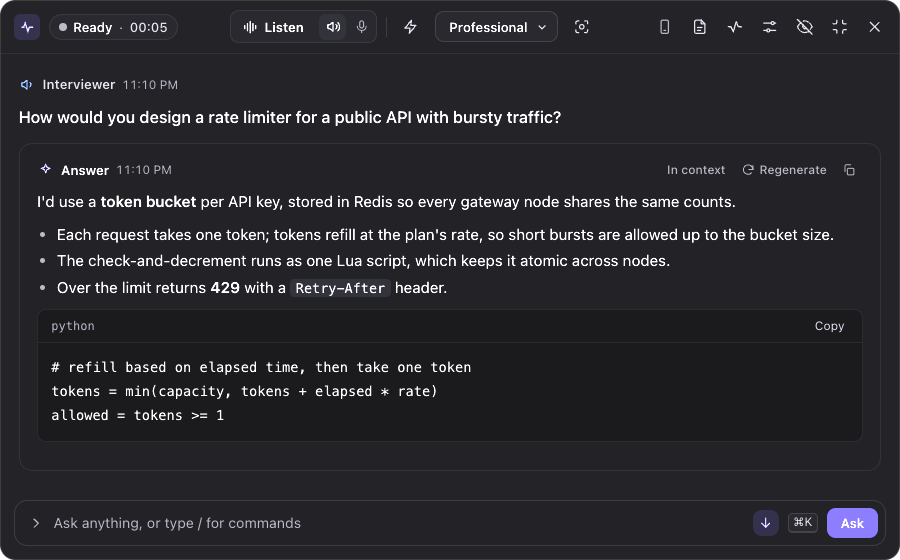
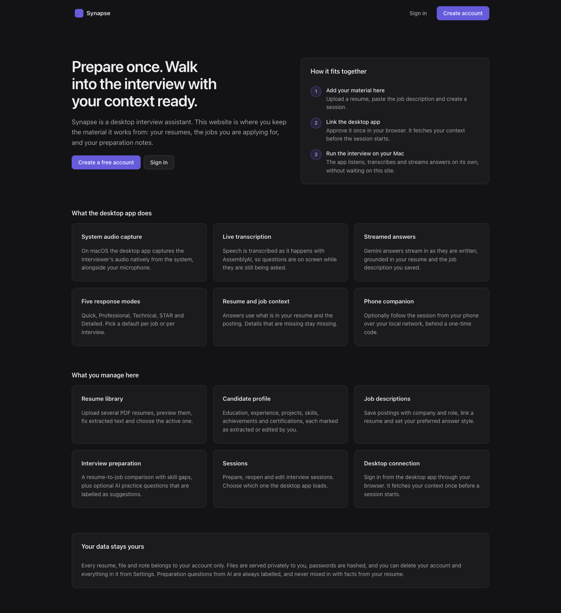
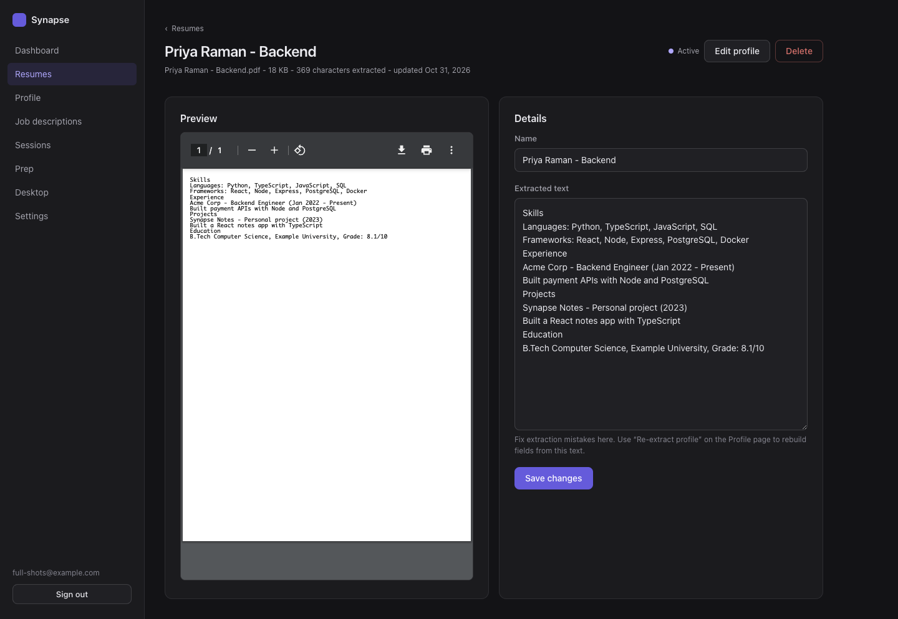
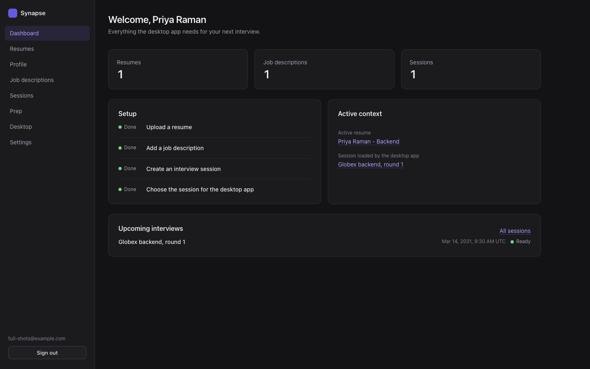
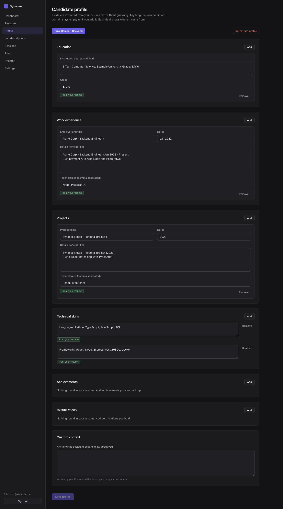
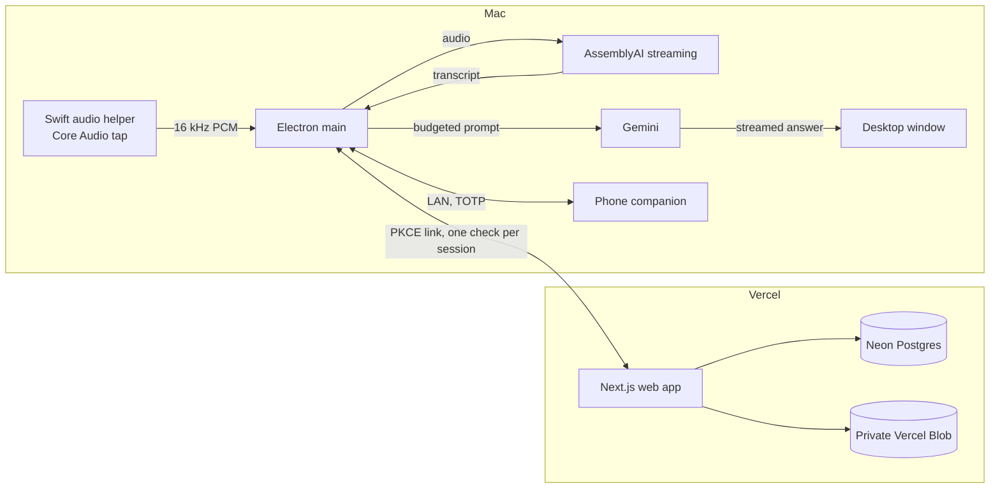
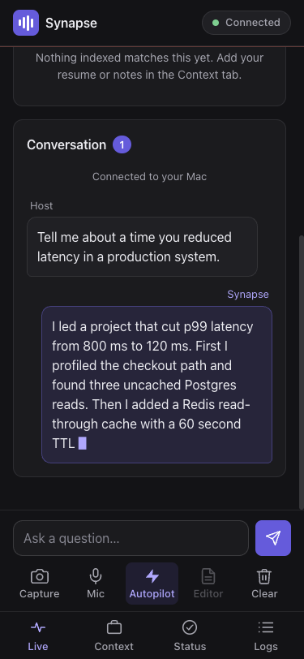

# Synapse

Synapse is a macOS desktop interview assistant with a companion website. The desktop app listens to your call, transcribes the interviewer as they speak, and streams a short, speakable answer grounded in your own resume and the job description. The website is where you keep that material: resumes, a candidate profile you can correct, job descriptions, prep sessions, and the link to your desktop app.



| Website | Resume and parsed text |
| --- | --- |
|  |  |
|  |  |

## What it does

**Desktop app (Electron, macOS)**
- Captures Mac system audio natively. Your speakers or headphones stay selected; no virtual audio device and no output switching. Core Audio process taps on macOS 14.2+, ScreenCaptureKit on 13.x.
- Live transcription with AssemblyAI streaming. Permanent provider errors (disabled key, no credit) stop retrying and say why; temporary ones back off with jitter.
- Streams Gemini answers on a priority lane, fails over between multiple API keys when one is rate limited, and lets you stop or regenerate an answer.
- Five response modes: Quick, Professional, Technical, STAR, Detailed. Answers use a plain "experienced engineer talking" style.
- Resume and job description context. The full resume is stored; each question receives only the relevant sections, and technologies are labeled as used at work, in projects, or only listed, so answers never claim more than the resume shows.
- Optional Ollama backend for a local model.
- Optional phone companion on your local network (see below).

**Website (Next.js 16, Postgres)**
- Email and password accounts.
- Resume library: upload PDFs up to 8 MB, preview, rename, replace, delete, reprocess. Full text is kept; parsing failures are shown, not hidden. Scanned PDFs without a text layer are refused with a message (no OCR).
- Candidate profile: experience, projects, education, skills and more, each marked as extracted or edited by you. Your edits survive reprocessing.
- Job descriptions, interview prep (a resume-to-job comparison plus optional AI practice questions labeled as suggestions), and sessions that choose what the desktop app loads.
- Desktop linking: approve the app once in your browser (OAuth-style PKCE over a 127.0.0.1 redirect). The desktop stores its token in the macOS Keychain, checks for newer context before a session, and only applies it when you confirm.

## Architecture



More detail: [docs/architecture.md](docs/architecture.md), [docs/web-platform.md](docs/web-platform.md), [docs/desktop-web-contract.md](docs/desktop-web-contract.md), [docs/design-system.md](docs/design-system.md).

| Area | Path |
| --- | --- |
| Native audio helper (Swift) | `native/macos-audio-capture/` |
| Electron main process | `src/main-process/` |
| Transcription, AI, context, web sync services | `src/services/` |
| Desktop window UI | `src/windows/assistant/` |
| Phone companion | `src/main-process/features/mobile-server/` |
| Website | `web/` |
| Desktop tests | `tests/` |
| Website tests | `web/tests/` |

## Requirements

- macOS 13 or later (14.2+ recommended for Core Audio taps). macOS 12 needs the legacy setup in [docs/BLACKHOLE-SETUP.md](docs/BLACKHOLE-SETUP.md).
- Node.js 22.
- Xcode Command Line Tools (`xcode-select --install`) to build the audio helper.
- An AssemblyAI API key and at least one Gemini API key, entered in the app's Settings.
- For the website locally: Postgres 15+.

## Desktop: install and run

```bash
git clone https://github.com/ank0xkernel/Synapse.git
cd Synapse
npm install
npm run build:native     # builds the universal audio helper
npm run dev              # run with logging
```

On first listen macOS asks for permission to capture system audio. Grant it in System Settings → Privacy & Security.

Optional flags live in `.env` (copy `.env.example`); API keys do not go there. Packaged builds never include `.env`.

Package the app:

```bash
npm run build:mac        # dist/ (ad-hoc signed; not notarized)
```

## Website: local development

```bash
cd web
npm install
cp .env.example .env.local      # set DATABASE_URL
createdb synapse_web_dev
npm run migrate
npm run dev
```

Without `BLOB_READ_WRITE_TOKEN`, PDFs are stored in Postgres (files up to 4.5 MB in this mode). With it, uploads go straight from the browser to private Vercel Blob.

## Website: deploy to Vercel

1. Import the GitHub repo in Vercel and set **Root Directory** to `web`. The build command comes from `web/vercel.json` (`npm run build:vercel`), which applies database migrations on production and preview builds, then runs `next build`.
2. In the project's **Storage** tab, add **Neon Postgres** (sets `DATABASE_URL`) and a **Private Blob** store (sets `BLOB_READ_WRITE_TOKEN`). Connect both to Production and Preview.
3. Optional: `GEMINI_API_KEY` for AI prep questions on the site.
4. Deploy, then open `/api/health`. It reports database and storage status without secrets.

Production builds fail, and the server refuses to start, without `DATABASE_URL` and `BLOB_READ_WRITE_TOKEN`. Migrations are additive; back up with Neon's point-in-time restore before running new ones on populated data.

## Phone companion

Off by default. Turn it on in the desktop app's Session panel, open the shown address on a phone on the same Wi-Fi, and sign in with the 6-digit code from the app. Each phone gets its own session (12 hours maximum, 60 minutes idle, up to 4 phones), which you can sign out or revoke. It shows the live transcript, streamed answers and past answers, and can send an answer to your editor.



The connection is plain HTTP on your local network. It is not encrypted, so use it only on a network you trust.

## Testing

```bash
npm test                                   # desktop: all test files
cd web && npx tsc --noEmit && npm test     # website (needs Postgres; TEST_DATABASE_URL to override)
node tests/test-web-desktop-e2e.mjs        # website-to-desktop E2E against a real next start + Postgres
```

GitHub Actions runs the desktop suite and native helper build on macOS, and the website typecheck, build, tests and the E2E on Linux with Postgres. Tests that capture real system audio need the macOS Audio Capture permission, so CI reports them as skipped; run them on a Mac.

## Security and privacy

- API keys are entered in Settings and stored in the app's per-user data; they are never bundled into builds or sent to the website.
- The desktop's website token is encrypted with Electron `safeStorage` (macOS Keychain) and never reaches the renderer.
- Website passwords are hashed with scrypt; all queries are parameterized and scoped to the signed-in user. Resume files are private: reads go through an ownership check and, on Vercel, a 2-minute signed URL.
- The website sends a strict Content-Security-Policy, HSTS in production, and no-store on private responses.
- Live answers never call the website; context is fetched once before a session and cached encrypted on the Mac.

## Troubleshooting

- **No transcript, "API key has been disabled or deleted"**: AssemblyAI rejected the key. Paste a new key in Settings.
- **Listening but silence**: check System Settings → Privacy & Security → Screen & System Audio Recording for Synapse, then run `node scripts/diagnose-audio-capture.js`.
- **Resume shows no experience or projects**: the resume needs clear section headings; resumes saved by older versions lost them, so import the PDF again or reprocess it on the website.
- **Website build fails on Vercel**: confirm Root Directory is `web` and both storage integrations are connected to the environment being built. The build stops with a message naming any missing variable. A project whose Root Directory is the repository root tries to package the desktop app and always fails; delete it or point it at `web`.

## Known limitations

- Real-device testing of the phone companion on iPhone and Android has not been done.
- Scanned PDFs are not supported (no OCR). Hyperlink targets hidden behind link text are not extracted; multi-column layouts follow the PDF's text order.
- The macOS build is ad-hoc signed, not notarized, so other Macs show a Gatekeeper warning.
- The packaged app is about 480 MB, mostly Electron and the optional local embedding model.
- Answer speed depends on Gemini and AssemblyAI availability; there is no offline transcription.

## License

MIT. See [LICENSE](LICENSE).

Synapse is an interview preparation tool. You are responsible for following the rules of any interview you use it in.
