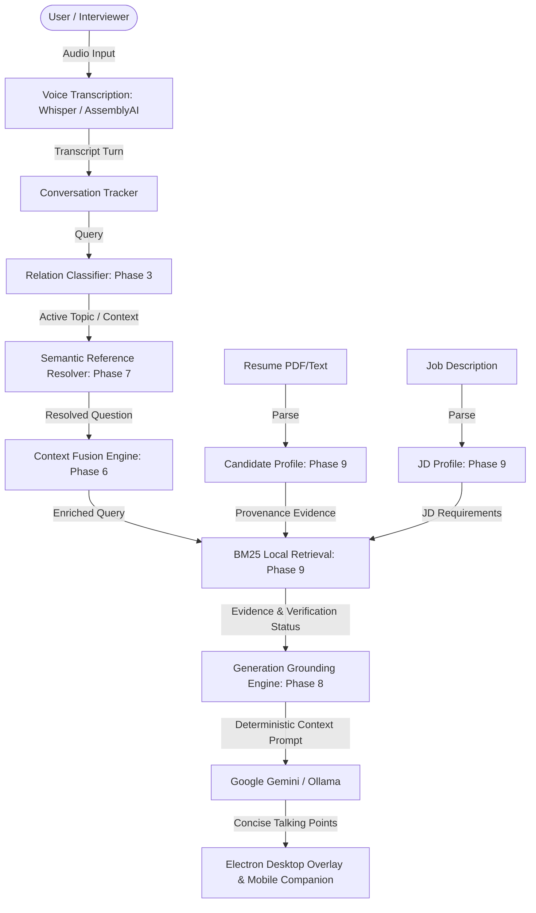

# Synapse

Synapse is an AI-powered, local-first real-time practice coach and live call assistant for software engineering interview preparation. It runs locally on your machine, captures system or microphone audio, transcribes conversation streams, tracks context across turns, retrieves highly specific provenance-backed evidence from your resume, and uses LLMs to generate experience-grounded, concise talking points.

---

## Product Overview

Preparing for technical interviews requires candidates to communicate experience clearly under pressure. Traditional mock interviews are hard to schedule, while generic LLMs often hallucinate details or produce verbose textbook answers. 

Synapse solves this by acting as a private, real-time desktop overlay and mobile companion. It runs locally to capture and transcribe call audio, classify interviewer questions, and dynamically retrieve exact evidence from your resume and the target job description. The system then formats experience-grounded prompts for Google Gemini or a local Ollama instance to present structured, clear talking points. By relying on a deterministic local retrieval pipeline, Synapse ensures every generated point remains strictly grounded in your actual accomplishments.

---

## Key Capabilities

*   **Real-time Question Classification & Relation Tracking:** Classifies questions into standalone technical, coding, system design, or behavioral categories and traces follow-ups, comparison questions, corrections, and refinements.
*   **Voice Transcription:** Low-latency local transcription via `whisper.cpp` (supporting Apple Neural Engine/Metal acceleration) or cloud transcription via AssemblyAI.
*   **Semantic Reference Resolution:** Resolves ambiguous pronouns (*"how does that scale?"*) and elliptical follow-ups back to the active conversation topic.
*   **Structured Candidate Intelligence:** Parses resumes into experience categories, projects, education, and skills, keeping a strict trace of source sections and lines (provenance).
*   **Job Description (JD) Intelligence:** Profiles target JDs, extracting responsibilities, required skills, and preferred requirements.
*   **Context-Aware BM25 Retrieval:** Employs local BM25-style lexical search with normalization, section weighting, and active-topic query enrichment. No external vector databases or paid subscriptions are required.
*   **Strict Grounding & Anti-Hallucination:** Derives verification levels (`VERIFIED_EXPERIENCE`, `PROJECT_EXPERIENCE`, `WORKED_WITH`, `UNKNOWN`) to ensure the AI never claims unsupported candidate experience or conflates JD requirements with candidate history.
*   **Desktop & Companion Dashboard:** Lightweight Electron desktop overlay with screen-share privacy (hidden from screenshot captures) paired with a responsive local network dashboard for mobile devices.
*   **TOTP Authentication:** Access to the local network dashboard and WebSockets is gated by a rotating 6-digit TOTP passcode shown on the desktop menu bar.

---

## System Architecture



---

## Context & Execution Layers

Synapse structures its execution pipeline into distinct, sequential engineering phases to build a deterministic context window before querying the LLM:

1.  **Relation Classification (Phase 3 & 6):** Every incoming question is classified (e.g., `CODING`, `SYSTEM_DESIGN`, `BEHAVIORAL`, `GENERAL_TECHNICAL`) and matched against the preceding turn to identify if it is a `NEW_TOPIC`, `FOLLOW_UP`, `COMPARISON`, `CORRECTION`, or `REFINEMENT`.
2.  **Semantic Reference Resolution (Phase 7):** Follow-up questions containing pronouns (*"why is it better?"*) or ellipses (*"and security?"*) are rewritten to explicitly attach the active topic (e.g., *"[Why is PostgreSQL better?]"*).
3.  **Candidate Intelligence (Phase 9):** Resume segments are converted into structured bullet nodes with metadata tracking their exact section and line number.
4.  **Local Retrieval & Verification (Phase 9 & 8):** The resolved question and active conversation topics enrich a BM25-lite query. Synapse retrieves matching candidate nodes and marks technologies as `VERIFIED_EXPERIENCE` (backed by professional work), `PROJECT_EXPERIENCE` (backed by project work), or `WORKED_WITH` (listed in skills).
5.  **Grounding Directives (Phase 8):** Custom system instructions force the model to lead with the direct answer, restrict output to experience-grounded facts, and output a specific fallback if no candidate evidence exists.

---

## Candidate Intelligence & Grounding

Synapse enforces a strict boundary between candidate history and JD requirements:
*   **Verification Precedence:** A technology mentioned in both professional experience and a raw skills list is classified at the strongest tier (`VERIFIED_EXPERIENCE`).
*   **No Experience Fabrication:** If a technology is requested in the JD but not found in the resume, it is flagged as `UNKNOWN` candidate experience. The generation engine is explicitly forbidden from claiming the candidate worked with it.
*   **Anti-Leakage Constraints:** Under-the-hood annotations and status labels are stripped from the final visible text block to prevent internal jargon from leaking into spoken or read responses.

---

## Retrieval Engine

Synapse utilizes a robust, deterministic **BM25-lite local lexical retrieval system**:
*   **Normalization:** Documents and queries are tokenized, downcased, and normalized to remove syntax noise.
*   **Section Weighting:** Searches are boosted depending on the query type (e.g., queries indicating academic history boost the `Education` section, whereas project queries boost `Projects`).
*   **Active-Topic Enrichment:** Terms representing the active topic from the live conversation are appended to the BM25 query to ensure relevant context is fetched even if the interviewer's question is brief.
*   **Vectorless Efficiency:** No remote vector databases, embedding APIs, or paid indexes are used. All calculations are executed locally and synchronously.

---

## AI Model Configuration

The cloud-based generation path is pre-configured for deterministic and low-latency coaching:
*   **Provider:** Google Gemini API
*   **Config Constraints:**
    *   `temperature`: `0.7` (balances responsiveness with conversational naturalness)
    *   `topP`: `0.95`
    *   `maxOutputTokens`: `800` (caps response length to prevent monologue-style answers)
*   **Context Orchestration:** The model is wrapped in an execution queue that enforces a minimum request interval (6 seconds) to prevent API rate-limiting and handles automatic key rotation upon auth or quota failures.

---

## Privacy & Security

*   **Local Processing:** When using the default local STT (Whisper) and local LLM (Ollama), no audio, transcript, or resume data is sent to the internet.
*   **Local Network Isolation:** The mobile server binds to your LAN IP. Access is gated by a cryptographically secure, rotating 6-digit TOTP passcode. The exchange of a correct TOTP code grants a random 32-byte session token, which must accompany all REST API calls and WebSocket upgrades.
*   **Screen-Share Privacy:** The desktop overlay utilizes native Electron window attributes to prevent contents from being captured by screen-sharing platforms (e.g., Zoom, Teams, Google Meet) when `HIDE_NOTES_FROM_SCREEN_SHARE=true` is set.

---

## Installation & Setup

### Prerequisites
*   Node.js (v18 or later)
*   macOS (v13 or later recommended for Core ML transcription)
*   *Optional:* BlackHole 2ch audio loopback driver for system capture

### Install Steps
1. Clone the repository and navigate to the project directory:
   ```bash
   git clone https://github.com/ank0xkernel/Synapse.git
   cd Synapse
   ```
2. Install dependencies:
   ```bash
   npm install
   ```
3. Set up the local environment file:
   ```bash
   cp .env.example .env
   ```

---

## Running Synapse

### Run Development Mode
Start the application with Electron logging enabled:
```bash
npm run dev
```

### Run Production Mode
Start the production packaged Electron main process:
```bash
npm start
```

### Build & Package (macOS)
To compile, package, and generate a macOS application bundle (`Synapse.app`):
```bash
npm run build:mac
```

---

## Verification & Testing

Synapse includes a complete suite of unit and integration tests verifying the context, reference resolution, prompt generation, and candidate intelligence layers.

| Module | Test File | Status | Expected Tests | Passed Tests |
| :--- | :--- | :--- | :--- | :--- |
| **Context Orchestration** | [`test-phase6-context-orchestration.mjs`](tests/test-phase6-context-orchestration.mjs) | **PASS** | 26 | 26 |
| **Semantic Reference** | [`test-phase7-semantic-reference.mjs`](tests/test-phase7-semantic-reference.mjs) | **PASS** | 19 | 19 |
| **Generation Grounding** | [`test-phase8-generation-grounding.mjs`](tests/test-phase8-generation-grounding.mjs) | **PASS** | 29 | 29 |
| **Candidate Intelligence** | [`test-phase9-candidate-intelligence.mjs`](tests/test-phase9-candidate-intelligence.mjs) | **PASS** | 33 | 33 |

Run the entire test suite using:
```bash
node tests/test-phase6-context-orchestration.mjs
node tests/test-phase7-semantic-reference.mjs
node tests/test-phase8-generation-grounding.mjs
node tests/test-phase9-candidate-intelligence.mjs
```

---

## Project Structure

```
├── README.md               # Product and engineering documentation
├── package.json            # Scripts, dependencies, and build configuration
├── LICENSE                 # MIT License file
├── .env.example            # Environment variables contract
├── src/
│   ├── main.js             # Core Electron entrypoint
│   ├── config.js           # Configuration registers and hotkeys
│   ├── bootstrap/          # Startup sanitization and environment setup
│   ├── main-process/       # Electron main process features
│   │   └── features/
│   │       ├── assistant/   # Gemini and Ollama runtimes
│   │       ├── mobile-server/# Local HTTP/WS dashboard & mobile companion
│   │       └── security/    # TOTP-auth implementation
│   ├── services/           # Reusable business logic services
│   │   ├── ai/             # Prompts, resume parser, and LLM connectors
│   │   ├── context/        # Candidate profiles, JD profiles, and matchers
│   │   └── stt/            # Speech-to-text adapters
│   └── windows/            # Electron window preloads, HTML templates, and styles
└── tests/                  # Phase 6-9 regression verification suites
```

---

## Engineering Principles

1.  **Context Before Generation:** Never query an LLM with a raw transcript. The conversation history, resolved references, and retrieved resume/JD facts must be merged into a single, deterministic block first.
2.  **No Assumed Experience:** If a candidate's resume does not explicitly document a skill or project, the system must not invent it or assume it.
3.  **Local-First & Vectorless:** Avoid external paid cloud architectures for search. A highly optimized, local BM25 engine is faster, free, and keeps user data private.
4.  **Preserved Provenance:** Every piece of evidence injected into the AI context must track its source (resume section and line index) for verification.

---

## Known Limitations

*   **Offline Mode Requires Configuration:** The default configuration calls Gemini. To run fully offline, you must have `Ollama` running locally with the target model downloaded.
*   **Layout Sensitivity:** Resume parsing assumes standard text boundaries. Non-standard multi-column PDF layouts or scanned images without a text layer will fail to parse.
*   **Active Semantic Embeddings:** Although local vector services exist in the repository, semantic embedding-based retrieval is currently not routed to the active Gemini/Ollama generation prompt.

---

## Roadmap

### Current Status
*   Deterministic text/audio context pipelines are fully verified (Phases 6–9).
*   Electron desktop overlay operates with active screen-share privacy.
*   Mobile companion WebSocket sync and TOTP gate are fully operational.

### Future Objectives
*   **Local Embeddings:** Activate the local semantic embedding service (`all-MiniLM-L6-v2`) in the main generation path.
*   **UX Refinement:** Redesign the local dashboard interface for cleaner visual telemetry.
*   **Auto-Correction Feedback:** Let candidates correct model responses via voice commands directly in the active session.

---

## License

This project is licensed under the terms of the MIT License. See [LICENSE](LICENSE) for details.

---

## Disclaimer

Synapse is an interview preparation and coaching tool. Users remain fully responsible for their own representations, answers, and compliance with the interview policies of hiring organizations.
